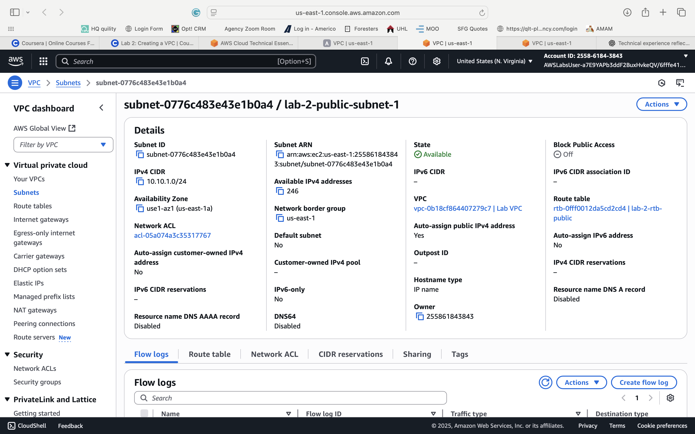
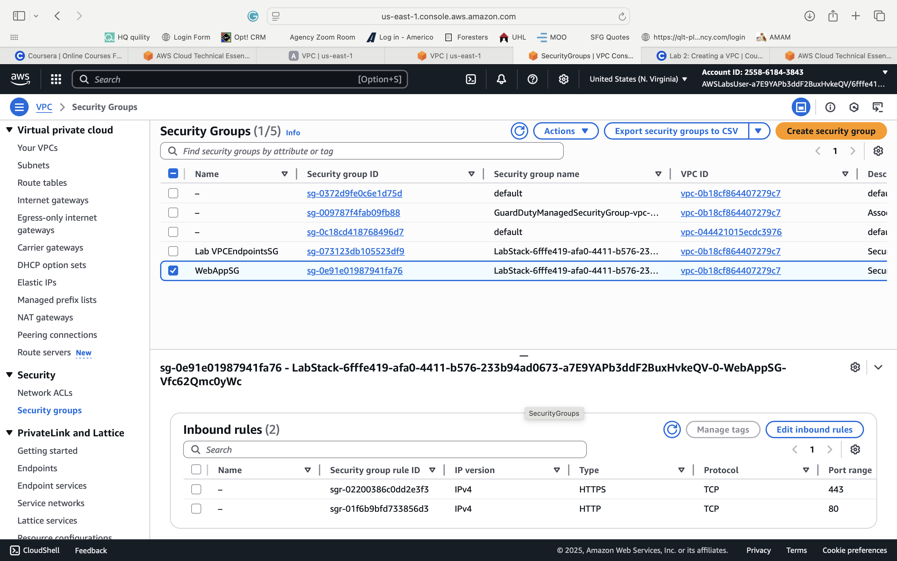
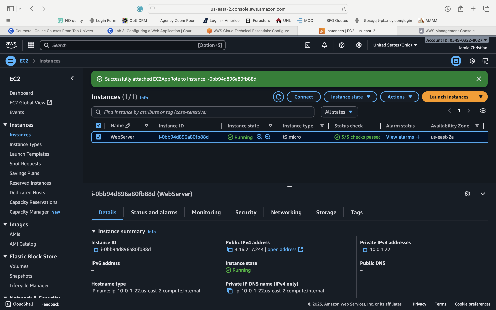
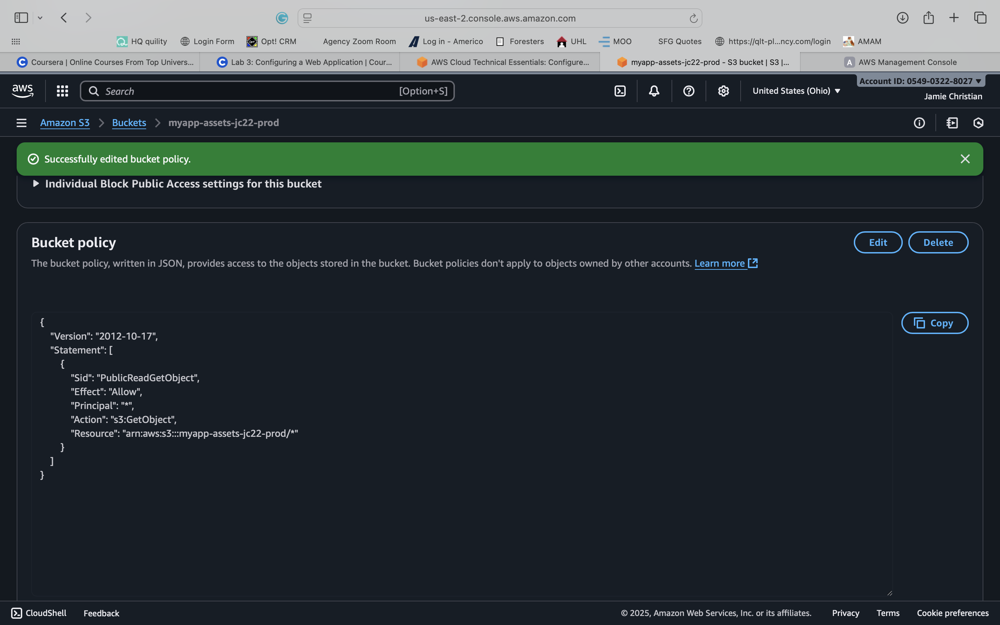
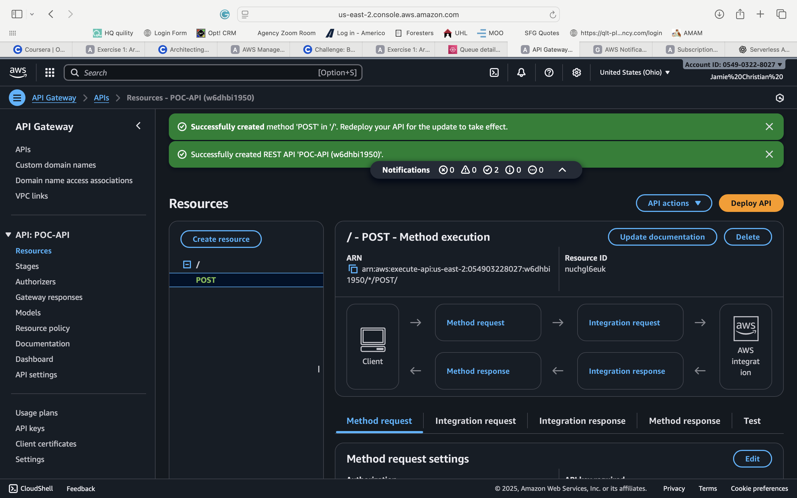
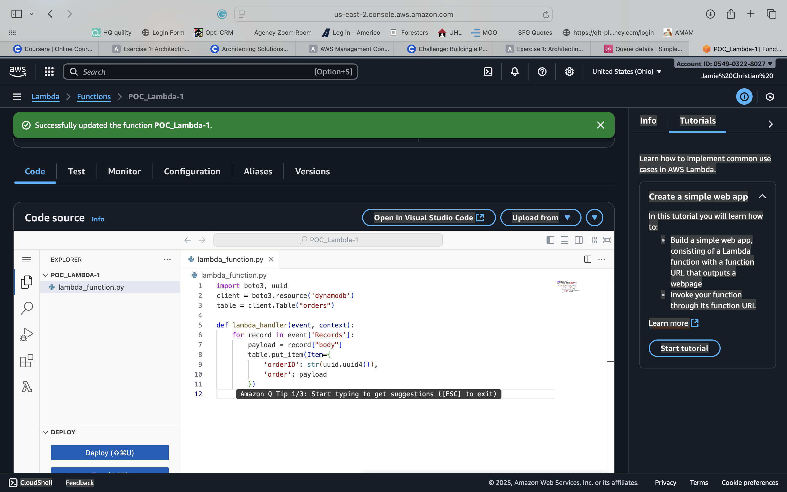
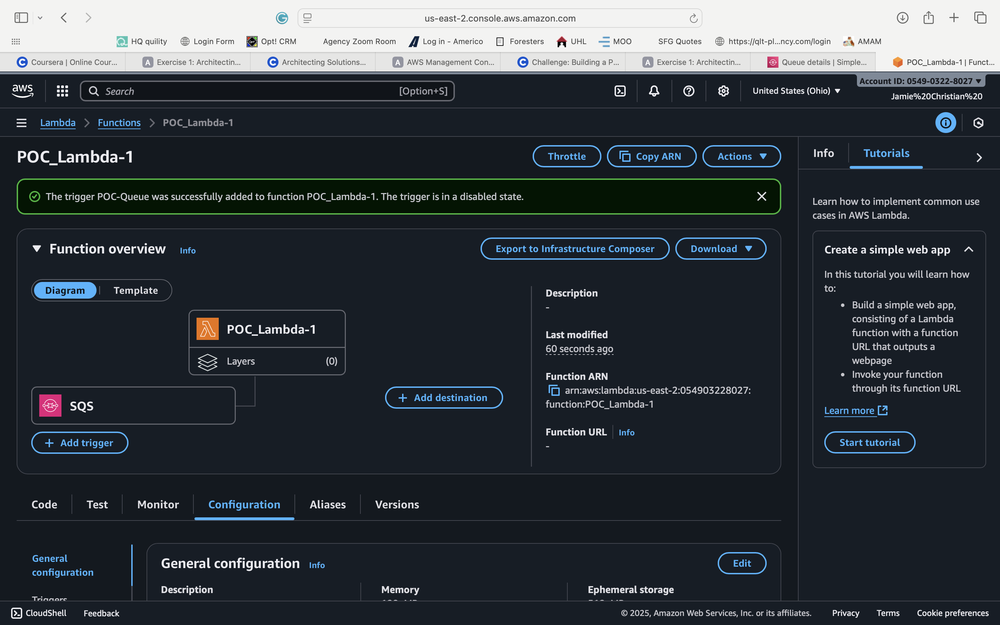
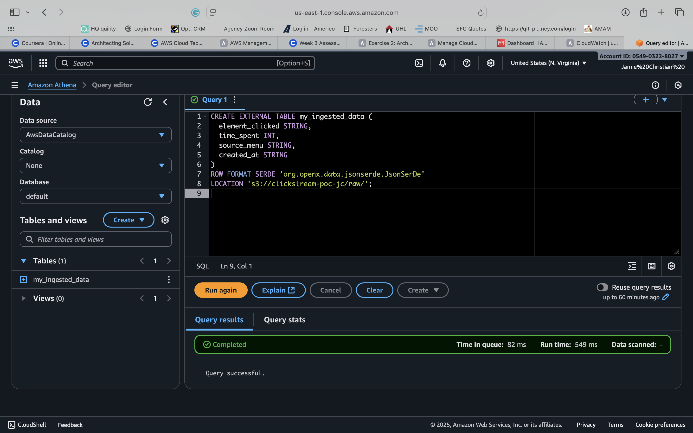

# 📸 AWS Security & Networking — Implementation Evidence Gallery

**Repository:** [AWS Security & Networking Portfolio](https://github.com/JamieChristian22/aws-security-networking)  
**Directory:** `Images/`  
**Cloud Platform:** Amazon Web Services (AWS)  
**Focus Areas:** Cloud Security, Networking, IAM, Serverless Architecture, Storage, Event-Driven Processing, and Data Analytics

---

## 📋 Overview

This directory contains screenshots documenting hands-on AWS configuration and implementation activities performed during the development of the AWS Security & Networking Portfolio.

The screenshots illustrate practical experience working with AWS infrastructure, identity and access management, network security controls, serverless applications, storage services, and cloud-based analytics.

The evidence is organized to help recruiters, hiring managers, cloud engineers, security analysts, and technical reviewers understand the AWS services explored and the implementation activities represented.

### Evidence Classification

**Evidence Type:** Historical implementation screenshots  
**Original Baseline Commit:** `6bac950d66ca1411bd664aa0ed891835d0468109`  
**Current Status:** Historical evidence preserved for technical reference

These screenshots were retained from an earlier version of the repository.

They demonstrate historical configuration activities but **do not independently verify that the current repository's replacement infrastructure, security policies, or application implementations have been deployed or successfully tested**.

Current deployment and testing claims must be supported by the repository's corresponding validation reports, execution logs, test results, and evidence ledgers.

---

## 🗂️ Screenshot Inventory

| # | AWS Service | Screenshot | Technical Focus |
|---|---|---|---|
| 01 | Amazon VPC | `VPC_Public_Subnet_Configuration.png` | Network segmentation and subnet configuration |
| 02 | Amazon VPC | `VPC_SecurityGroup_WebAppSG.png` | Network traffic filtering and security groups |
| 03 | AWS IAM | `IAM_Role_EC2AppRole_Created.png` | Identity management and role-based access |
| 04 | Amazon S3 | `S3_Bucket_Creation_Success.png` | Cloud object storage configuration |
| 05 | Amazon API Gateway | `API_Gateway_POST_Method_Creation_POC-API.png` | REST API method configuration |
| 06 | AWS Lambda | `AWS_Lambda_Python_Code_DynamoDB_PutItem_POC-Lambda-1.png` | Serverless Python and DynamoDB integration |
| 07 | AWS Lambda / Amazon SQS | `AWS_Lambda_SQS_Trigger_Configuration_POC-Lambda-1.png` | Event-driven message processing |
| 08 | Amazon Athena / S3 | `Amazon_Athena_External_Table_Creation_S3_Clickstream.png` | Serverless SQL analytics |

---

# 🌐 01. AWS Networking & Infrastructure Security

## 1.1 Amazon VPC — Public Subnet Configuration

**Screenshot:** `VPC_Public_Subnet_Configuration.png`

### Objective

Document the configuration of a public subnet within an Amazon Virtual Private Cloud (VPC).

### Technical Concepts

- Virtual Private Cloud network isolation
- IPv4 CIDR addressing
- Subnet allocation
- Availability Zone placement
- Public and private network segmentation
- Routing and internet connectivity
- AWS networking fundamentals

### Implementation Context

Amazon VPC enables cloud engineers to define logically isolated networks for AWS resources.

A subnet divides a VPC address space into smaller network segments, supporting workload organization and security boundaries.

A subnet is considered public when its associated route table provides an appropriate route to an internet gateway. The subnet's name alone does not establish public connectivity.

### Security Considerations

Production implementations should verify:

- Correct subnet CIDR allocation
- Intended route-table associations
- Internet gateway configuration
- Public IP assignment behavior
- Network ACL configuration
- Security group restrictions
- Separation of public-facing and internal workloads

### Validation Requirements

A complete implementation should include evidence of subnet creation, route-table association, expected routing behavior, and network connectivity testing.

**Evidence Limitation:** The screenshot documents a historical subnet configuration view. It does not independently prove routing correctness, internet reachability, or compliance with current security requirements.

---

## 1.2 Amazon VPC — Web Application Security Group

**Screenshot:** `VPC_SecurityGroup_WebAppSG.png`

### Objective

Document the creation or configuration of an AWS security group intended to control network access to a web application.

### Technical Concepts

- Stateful network filtering
- Inbound traffic rules
- Outbound traffic rules
- TCP/IP networking
- Source and destination restrictions
- Application-layer exposure
- Least-privilege network access

### Implementation Context

AWS security groups act as stateful virtual firewalls for supported resources.

Security group rules control permitted inbound and outbound traffic according to protocol, port, and source or destination.

For a web application, an appropriately designed security group may permit HTTPS traffic while restricting administrative access to approved networks or managed access mechanisms.

### Security Best Practices

Recommended production controls include:

- Allow only necessary application ports
- Prefer HTTPS for public web traffic
- Restrict administrative ports
- Avoid unrestricted SSH or RDP exposure
- Review outbound permissions
- Document the business purpose of each rule
- Remove obsolete rules
- Periodically review attached resources

### Validation Requirements

Security group validation should include rule inspection, authorized connectivity tests, unauthorized connectivity tests, and confirmation of attachment to intended resources.

**Evidence Limitation:** The screenshot alone does not establish that all rules follow least privilege or that traffic restrictions have passed security testing.

---

# 🔐 02. Identity & Access Management

## 2.1 AWS IAM — EC2 Application Role

**Screenshot:** `IAM_Role_EC2AppRole_Created.png`

### Objective

Document an IAM role configuration intended to support AWS resource access from an EC2-hosted application.

### Technical Concepts

- IAM roles
- Role trust policies
- Permission policies
- Temporary security credentials
- AWS service principals
- Role-based access control
- Least-privilege authorization
- EC2 instance profiles

### Implementation Context

IAM roles provide temporary credentials that AWS workloads can use to access authorized services without embedding long-term access keys in application source code.

For an EC2 application, a correctly configured role can be associated with an instance through an instance profile.

### Security Best Practices

A secure implementation should:

- Grant only necessary permissions
- Restrict access to required resources
- Validate the role trust policy
- Avoid unnecessary wildcard permissions
- Use temporary credentials
- Avoid hardcoded secrets
- Monitor sensitive API activity
- Review permissions periodically

### Validation Requirements

A complete validation process should confirm that the intended EC2 workload can assume the role, perform authorized operations, and receive access-denied responses for unauthorized operations.

**Evidence Limitation:** Historical role creation does not independently prove effective permissions, correct instance-profile association, or successful authorization testing.

---

# 🪣 03. Cloud Storage Security

## 3.1 Amazon S3 — Bucket Creation

**Screenshot:** `S3_Bucket_Creation_Success.png`

### Objective

Document the creation of an Amazon S3 bucket for cloud object storage.

### Technical Concepts

- S3 bucket provisioning
- Object storage
- Bucket policies
- Public Access Block
- Server-side encryption
- Versioning
- Object ownership
- Storage access management

### Implementation Context

Amazon S3 provides scalable object storage for application data, logs, backups, analytics datasets, and other workloads.

Secure bucket provisioning requires consideration of both data protection and access control.

### Security Best Practices

Recommended controls include:

- Enable S3 Block Public Access unless public access is explicitly required
- Apply least-privilege bucket and IAM policies
- Use server-side encryption
- Enable versioning where appropriate
- Restrict cross-account access
- Apply lifecycle management policies
- Monitor sensitive object access
- Avoid exposing confidential data

### Validation Requirements

Validation should confirm bucket existence, intended access restrictions, encryption configuration, versioning settings, and authorized and unauthorized access behavior.

**Evidence Limitation:** Successful bucket creation does not prove that all security controls were enabled or validated.

---

# 🔌 04. API Security & Serverless Integration

## 4.1 Amazon API Gateway — POST Method Configuration

**Screenshot:** `API_Gateway_POST_Method_Creation_POC-API.png`

### Objective

Document the configuration of an HTTP POST method in Amazon API Gateway.

### Technical Concepts

- REST API development
- HTTP methods
- API Gateway resources
- Backend integrations
- Request processing
- Authorization mechanisms
- Input validation
- API logging and monitoring

### Implementation Context

Amazon API Gateway provides a managed interface for exposing backend services through APIs.

A POST method is commonly used to submit data for processing or resource creation.

Depending on the architecture, API Gateway can integrate with AWS Lambda and other AWS services.

### Security Best Practices

A production-ready API should consider:

- Appropriate authentication and authorization
- Input validation
- Request throttling
- HTTPS enforcement
- Controlled cross-origin resource sharing
- Safe error handling
- CloudWatch logging
- Protection of sensitive request data

### Validation Requirements

API validation should include authorized requests, malformed payloads, unauthorized requests, expected status codes, and backend integration testing.

**Evidence Limitation:** The screenshot establishes historical method configuration context, not successful API deployment, authentication enforcement, or end-to-end request processing.

---

## 4.2 AWS Lambda — Python and DynamoDB PutItem

**Screenshot:** `AWS_Lambda_Python_Code_DynamoDB_PutItem_POC-Lambda-1.png`

### Objective

Document a Python-based AWS Lambda proof of concept involving a DynamoDB `PutItem` operation.

### Technical Concepts

- AWS Lambda
- Python application development
- Amazon DynamoDB
- AWS SDK for Python (Boto3)
- Serverless data processing
- IAM execution roles
- Application error handling

### Implementation Context

AWS Lambda runs application code without requiring developers to manage underlying servers.

A Lambda function can interact with DynamoDB to write structured records to a database table, provided the function has the necessary permissions and receives valid input.

### Security Considerations

A secure implementation should:

- Validate incoming data
- Restrict DynamoDB permissions
- Avoid hardcoded credentials
- Handle AWS SDK errors
- Protect sensitive information in logs
- Configure appropriate timeouts
- Consider retry and duplicate-processing behavior
- Monitor function failures

### Validation Requirements

A complete test should verify successful invocation, expected DynamoDB writes, invalid-input handling, permission-denied behavior, and relevant execution logs.

**Evidence Limitation:** A code screenshot does not prove that the function was invoked successfully or that a record was persisted to DynamoDB.

---

# 📩 05. Event-Driven Architecture

## 5.1 AWS Lambda — Amazon SQS Trigger

**Screenshot:** `AWS_Lambda_SQS_Trigger_Configuration_POC-Lambda-1.png`

### Objective

Document an Amazon SQS event-source configuration associated with AWS Lambda.

### Technical Concepts

- Event-driven architectures
- Asynchronous message processing
- Amazon Simple Queue Service
- Lambda event-source mappings
- Batch processing
- Message visibility timeouts
- Retry handling
- Dead-letter queues
- Failure isolation

### Implementation Context

Amazon SQS enables applications to exchange messages asynchronously.

AWS Lambda can poll an SQS queue through an event-source mapping and invoke a function to process received messages.

This architecture can improve workload decoupling and resilience.

### Reliability Considerations

A production implementation should account for:

- Duplicate message delivery
- Idempotent processing
- Visibility timeout configuration
- Failed-message handling
- Dead-letter queue policies
- Batch size selection
- Processing concurrency
- Monitoring queue backlogs

### Validation Requirements

Testing should demonstrate successful message processing, retry behavior, failure handling, and correct queue-message lifecycle behavior.

**Evidence Limitation:** The historical trigger screenshot does not independently prove successful message delivery, processing, retry behavior, or failure recovery.

---

# 📊 06. Data Analytics & Query Processing

## 6.1 Amazon Athena — S3 Clickstream External Table

**Screenshot:** `Amazon_Athena_External_Table_Creation_S3_Clickstream.png`

### Objective

Document the creation or configuration of an Amazon Athena external table intended for clickstream data stored in Amazon S3.

### Technical Concepts

- Serverless SQL analytics
- External table definitions
- Amazon S3 data sources
- Schema-on-read
- Data catalog integration
- Clickstream data analysis
- Data access permissions
- Query execution and validation

### Implementation Context

Amazon Athena allows users to query data stored in Amazon S3 using SQL without managing a traditional database server.

External table definitions describe how Athena interprets the underlying data.

### Security and Governance Considerations

Production implementations should consider:

- Least-privilege access to source data
- Controlled query-result storage
- Encryption of sensitive data
- Data classification
- Catalog permissions
- Schema consistency
- Query cost management
- Data retention requirements

### Validation Requirements

A complete implementation should demonstrate successful table creation, valid schema interpretation, successful SQL queries, and appropriate access controls.

**Evidence Limitation:** A table-definition screenshot does not independently prove successful queries, accurate results, or secure data access.

---

# 🧪 07. Evidence Quality & Validation Framework

The portfolio separates configuration evidence from operational and security testing.

| Evidence Level | Description | Verification Value |
|---|---|---|
| L1 — Configuration | AWS Console screenshots showing configuration activities | Historical configuration context |
| L2 — Implementation | Infrastructure code and application source files | Reviewable implementation design |
| L3 — Execution | CLI output, deployment records, or runtime logs | Evidence of execution |
| L4 — Functional Validation | Passing tests and expected application behavior | Evidence of functional correctness |
| L5 — Security Validation | Positive and negative access tests, policy checks, and security scans | Evidence of tested security controls |
| L6 — Reproducibility | Documented deployment steps and repeatable automated validation | Evidence supporting repeatable implementation |

The screenshots in this directory are primarily **L1 evidence**.

Higher evidence levels must be established independently using current implementation artifacts and verifiable test outputs.

## Recommended Validation Coverage

| Component | Functional Validation | Security Validation |
|---|---|---|
| VPC subnet | Route and connectivity checks | Segmentation and exposure review |
| Security group | Allowed traffic connectivity | Unauthorized traffic rejection |
| IAM role | Authorized AWS operations | Unauthorized action denial |
| S3 bucket | Object upload and retrieval | Public-access and permission checks |
| API Gateway | Expected HTTP responses | Authentication and input-validation tests |
| Lambda / DynamoDB | Successful invocation and record persistence | IAM and malformed-input tests |
| Lambda / SQS | Message processing and failure recovery | Queue permissions and failure isolation |
| Athena | Successful SQL queries | Data and query-result access restrictions |

**Important:** This matrix defines recommended verification coverage. It does not claim that these tests have been completed.

---

# 🛡️ 08. Screenshot Security & Privacy

Before publishing or reusing AWS Console screenshots, review them for sensitive information.

Potentially sensitive content includes:

- AWS account identifiers
- Resource ARNs
- Public IP addresses
- Internal network addresses
- Access keys and credentials
- Session tokens
- Secret values
- Customer or personal information
- Sensitive infrastructure naming conventions

Resource identifiers are not automatically secrets, but they may reveal infrastructure details that should be assessed before public disclosure.

Never publish active credentials, secret values, or private customer data.

Where redaction is required, preserve the technical context while removing sensitive details.

---

# 🔗 09. Repository Navigation

**Main Portfolio:**  
[aws-security-networking](https://github.com/JamieChristian22/aws-security-networking)

**Screenshot Directory:**  
[Images/](https://github.com/JamieChristian22/aws-security-networking/tree/main/Images)

**Original Historical Baseline:**  
[Commit 6bac950](https://github.com/JamieChristian22/aws-security-networking/commit/6bac950d66ca1411bd664aa0ed891835d0468109)

For current implementation status, consult the main repository documentation, implementation files, evidence ledgers, and release validation reports.

---

# 🎯 10. Professional Skills Demonstrated

This historical evidence collection provides supporting context for hands-on learning across the following areas:

| Competency | Relevant AWS Services |
|---|---|
| Cloud Infrastructure | Amazon VPC, Amazon EC2 |
| Network Security | VPC Subnets, Security Groups |
| Identity & Access Management | AWS IAM |
| Cloud Storage | Amazon S3 |
| Serverless Computing | AWS Lambda |
| API Integration | Amazon API Gateway |
| NoSQL Database Integration | Amazon DynamoDB |
| Event-Driven Processing | Amazon SQS |
| Cloud Analytics | Amazon Athena |
| Python Development | AWS Lambda, Boto3 |

These competencies are relevant to cloud support, cloud engineering, AWS infrastructure, cloud security, and technical operations roles.

The screenshots are supporting portfolio artifacts rather than standalone proof of production-level proficiency.

---

# 📌 11. Evidence Integrity Statement

This directory intentionally preserves original historical screenshots instead of presenting them as new deployment results.

The distinction is important for maintaining technical accuracy, transparency, and professional credibility.

**Evidence Integrity Principles:**

1. Historical screenshots retain their original evidentiary context.
2. Current deployment claims require current deployment evidence.
3. Successful testing must be supported by actual execution results.
4. Security compliance must not be inferred solely from configuration screenshots.
5. Simulated, example, and proposed implementations must be identified appropriately.
6. Sensitive information must be reviewed before public publication.

---

## ✅ Summary

The `Images/` directory provides a structured visual record of historical AWS configuration and implementation activities spanning networking, identity management, storage, serverless computing, API integration, messaging, and analytics.

Combined with source code, infrastructure definitions, documented testing procedures, and independently verifiable execution evidence, these screenshots help communicate the technical scope and development history of the AWS Security & Networking Portfolio.

**Maintained by:** Jamie Christian  
**GitHub:** [JamieChristian22](https://github.com/JamieChristian22)  
**Portfolio:** [AWS Security & Networking](https://github.com/JamieChristian22/aws-security-networking)

*Documentation is maintained with an emphasis on technical accuracy, evidence integrity, security awareness, and professional portfolio presentation.*
