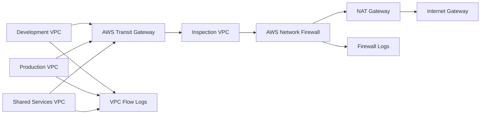
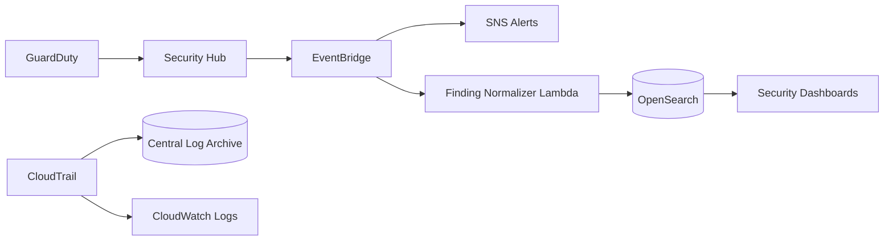
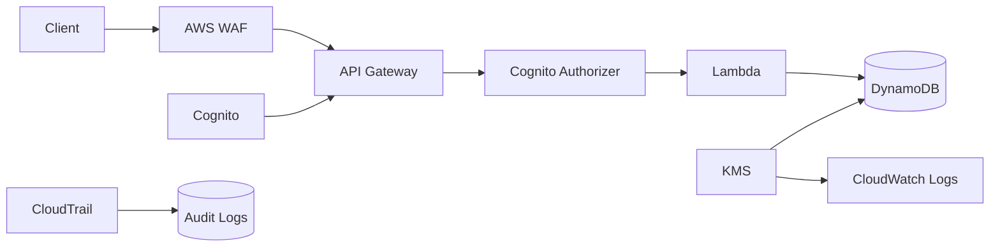

# 🔐 AWS Security + Networking Portfolio


> **AWS Security Engineering • Cloud Networking • IAM Governance • Detection Engineering • Serverless Security • Terraform • Incident Response**

A comprehensive AWS security and networking portfolio demonstrating how cloud environments can be designed around **segmentation, least privilege, centralized inspection, threat detection, secure application architecture, infrastructure as code, operational response, and measurable security controls**.

This repository goes beyond isolated AWS labs.

Each project follows a complete security-engineering lifecycle:

**Requirement → Threat → Architecture → Control → Terraform → Validation → Evidence → Operations → Continuous Improvement**

---

# 🎯 Portfolio Focus

This portfolio is designed around work commonly performed by:

- Cloud Security Engineers
- AWS Security Engineers
- Cloud Security Analysts
- Cloud Infrastructure Engineers
- AWS Network Engineers
- Junior DevSecOps Engineers
- Cloud Operations Engineers
- Solutions Architects
- Security Operations Engineers

The projects demonstrate both:

## Preventive Security

```text
Network Segmentation
IAM Guardrails
Permission Boundaries
AWS WAF
Private Service Access
KMS Encryption
Security Groups
SCPs
```

and:

## Detective / Responsive Security

```text
CloudTrail
GuardDuty
Security Hub
EventBridge
CloudWatch
VPC Flow Logs
Network Firewall Logs
OpenSearch
SNS
Incident Runbooks
```

---

# 🧭 Start Here

| Project | Primary Focus | Portfolio Depth |
|---|---|---:|
| **01 — Secure Multi-Account Network Core** | Network segmentation + centralized inspection | ⭐⭐⭐⭐⭐ |
| **02 — IAM Zero-Trust Guardrails** | Identity governance + privilege controls | ⭐⭐⭐⭐⭐ |
| **03 — Centralized Security Logging & Detection** | Detection engineering + centralized telemetry | ⭐⭐⭐⭐⭐ |
| **04 — Secure Serverless API** | Application/API security | ⭐⭐⭐⭐⭐ |

---

# 🗂️ Repository Structure

```text
aws-security-networking/
│
├── README.md
│
├── docs/
│   ├── Portfolio_Control_Matrix.md
│   └── Portfolio_Architecture_Review.md
│
├── projects/
│   │
│   ├── 01-network-core/
│   │   ├── README.md
│   │   ├── docs/
│   │   │   ├── Threat-Model.md
│   │   │   ├── Validation-Checklist.md
│   │   │   ├── Runbook.md
│   │   │   ├── ADR-001-Centralized-Inspection.md
│   │   │   ├── Failure_Mode_Analysis.md
│   │   │   └── Cost_Model.md
│   │   ├── iac/
│   │   │   └── terraform/
│   │   └── evidence/
│   │
│   ├── 02-iam-guardrails/
│   │   ├── README.md
│   │   ├── docs/
│   │   │   ├── Threat-Model.md
│   │   │   ├── Validation-Checklist.md
│   │   │   ├── Runbook.md
│   │   │   ├── ADR-001-BreakGlass.md
│   │   │   └── scp-pack/
│   │   ├── iac/
│   │   │   └── terraform/
│   │   └── evidence/
│   │
│   ├── 03-security-logging-detection/
│   │   ├── README.md
│   │   ├── docs/
│   │   │   ├── Detection_Catalog.md
│   │   │   ├── Threat-Model.md
│   │   │   ├── Detection_Engineering_Methodology.md
│   │   │   ├── Runbook.md
│   │   │   └── Cost_Model.md
│   │   ├── lambda/
│   │   ├── iac/
│   │   │   └── terraform/
│   │   └── evidence/
│   │
│   └── 04-secure-serverless-api/
│       ├── README.md
│       ├── docs/
│       │   ├── Threat-Model.md
│       │   ├── Validation-Checklist.md
│       │   ├── Runbook.md
│       │   ├── ADR-001-Managed-Auth.md
│       │   ├── Failure_Mode_Analysis.md
│       │   └── Cost_Model.md
│       ├── lambda/
│       ├── iac/
│       │   └── terraform/
│       └── evidence/
│
├── evidence/
│   ├── artifact_manifest.csv
│   └── FINAL_COMPLETENESS_REPORT.md
│
├── validation/
│   └── validate_portfolio.py
│
└── .github/
    └── workflows/
        └── ci.yml
```

---

# 🛡️ Security Engineering Philosophy

The portfolio is built around four major security layers.

```text
NETWORK PLANE
      ↓
IDENTITY PLANE
      ↓
DETECTION PLANE
      ↓
APPLICATION PLANE
```

Each project focuses on a different layer while connecting to the others.

---

# 🌐 Project 01 — Secure Multi-Account Network Core

[`projects/01-network-core/`](projects/01-network-core/)

A centralized AWS networking security architecture built around:

- Amazon VPC
- AWS Transit Gateway
- Inspection VPC
- AWS Network Firewall
- NAT Gateway
- Route-table segmentation
- VPC Flow Logs
- Centralized egress
- Security telemetry

---

# 🏗️ Network Architecture



---

# 🎯 Network Security Objectives

The architecture is designed so that:

```text
Development
    ✕
Production
```

does not automatically have direct lateral connectivity.

Internet-bound traffic follows:

```text
Spoke VPC
    ↓
Transit Gateway
    ↓
Inspection VPC
    ↓
AWS Network Firewall
    ↓
NAT Gateway
    ↓
Internet
```

---

# 🔐 Network Controls

Controls include:

- Explicit TGW route tables
- Controlled route propagation
- Inspection VPC
- AWS Network Firewall
- Security groups
- VPC Flow Logs
- Central firewall logging
- Controlled egress
- Private workload networks

---

# 🧠 Network Threat Model

Threats addressed include:

| Threat | Architecture Control |
|---|---|
| Lateral movement | TGW route isolation |
| Uninspected internet traffic | Central egress inspection |
| Command-and-control traffic | Network Firewall |
| Reconnaissance | Network segmentation |
| Data exfiltration | Egress inspection |
| Investigation blind spots | Flow Logs + Firewall Logs |

---

# 🧪 Network Validation

The project defines tests for:

```text
Dev → Prod direct route
Expected: DENIED

Spoke → HTTPS Internet
Expected: ALLOWED THROUGH INSPECTION

Spoke → Prohibited Port
Expected: DENIED

Firewall Event
Expected: LOGGED

Rejected Flow
Expected: PRESENT IN FLOW LOG
```

The evidence directory includes both a validation matrix and simulated architecture-validation results.

Live Reachability Analyzer or firewall screenshots are not fabricated when a live AWS execution has not occurred.

---

# 🚦 Network Failure Analysis

The project evaluates failures such as:

- Transit Gateway attachment issues
- Firewall endpoint failure
- NAT Gateway failure
- Incorrect route propagation
- Lost security logging

Each failure is tied to:

```text
Detection
   ↓
Containment
   ↓
Recovery
   ↓
Validation
```

---

# 👤 Project 02 — IAM Zero-Trust Guardrails

[`projects/02-iam-guardrails/`](projects/02-iam-guardrails/)

A layered AWS identity-governance architecture demonstrating:

- IAM roles
- Permission boundaries
- AWS Organizations SCP concepts
- Least privilege
- Break-glass administration
- MFA
- CloudTrail monitoring
- Security-event validation

---

# 🏗️ IAM Control Model

```text
AWS Organizations
        ↓
Service Control Policy
        ↓
Permission Boundary
        ↓
IAM Role Policy
        ↓
Temporary Role Session
        ↓
AWS Resource
        ↓
CloudTrail
```

This demonstrates that effective IAM security is created through **multiple policy layers**, not a single role policy.

---

# 🛡️ Zero-Trust IAM Principles

The project follows:

```text
Never Assume
Always Authenticate
Authorize Explicitly
Minimize Privilege
Use Temporary Credentials
Log Privileged Activity
Review Emergency Access
```

---

# 🚫 Organization Guardrails

Example restrictions include:

### Protect CloudTrail

```text
cloudtrail:StopLogging
cloudtrail:DeleteTrail
```

Expected:

**DENIED**

---

### Prevent Organization Exit

```text
organizations:LeaveOrganization
```

Expected:

**DENIED**

---

### Protect S3 Public Access Controls

Security-control changes can be denied at the organizational layer.

---

# 🧱 Permission Boundaries

Permission boundaries limit the maximum privileges delegated roles can receive.

Example:

```text
Identity Policy
      ∩
Permission Boundary
      ↓
Effective Permissions
```

Even if an overly broad identity policy is attached, the boundary prevents permissions outside the approved security envelope.

---

# 👥 Role Model

Example roles include:

### `ReadOnlyAuditorRole`

Used for:

- Configuration inspection
- Inventory
- Audit
- Security review

No resource mutation.

---

### `IncidentResponderRole`

Used for:

- GuardDuty investigation
- Security Hub findings
- CloudTrail review
- Controlled incident actions

---

### `DeployerRole`

Used for approved application or infrastructure deployment.

---

### `BreakGlassAdminRole`

Used only during emergency recovery.

Controls include:

- MFA
- Short-lived sessions
- Explicit approval
- CloudTrail logging
- Immediate security notification
- Mandatory post-use review

---

# 🧪 IAM Validation Matrix

| Test | Expected |
|---|---|
| Create role without approved boundary | **DENIED** |
| Stop CloudTrail | **DENIED** |
| Leave AWS Organization | **DENIED** |
| Read-only role creates S3 bucket | **DENIED** |
| Break-glass without MFA | **DENIED** |
| Approved break-glass session | **ALLOWED + ALERTED** |

This is one of the strongest interview artifacts in the repository because it demonstrates that security policies are intended to be **tested**, not simply written.

---

# 🔎 Project 03 — Centralized Security Logging & Detection

[`projects/03-security-logging-detection/`](projects/03-security-logging-detection/)

A centralized AWS security-monitoring architecture demonstrating:

- AWS CloudTrail
- Amazon GuardDuty
- AWS Security Hub
- Amazon EventBridge
- AWS Lambda
- Amazon OpenSearch Service
- Amazon SNS
- CloudWatch
- S3 log archive
- Detection engineering

---

# 🏗️ Detection Architecture



---

# 🎯 Detection Goals

The architecture provides:

- Central security visibility
- API audit history
- GuardDuty threat findings
- Security Hub aggregation
- Automated finding routing
- Searchable investigations
- Severity-based response
- Long-term security evidence

---

# 🚨 Detection Catalog

Example detections include:

| Detection | Source | Severity |
|---|---|---|
| High / Critical GuardDuty Finding | GuardDuty | SEV-1 / SEV-2 |
| CloudTrail Stopped | CloudTrail | SEV-1 |
| Root Account Activity | CloudTrail | SEV-1 |
| IAM Policy Change | CloudTrail | SEV-2 |
| Security Group Opened Broadly | AWS Config / Event | SEV-2 |
| Break-Glass Role Used | CloudTrail | SEV-1 / SEV-2 |

---

# 🧠 Detection Engineering Method

Every detection follows:

```text
Threat Hypothesis
      ↓
Telemetry Source
      ↓
Detection Rule
      ↓
Severity
      ↓
False Positive Review
      ↓
Runbook
      ↓
Safe Test
      ↓
Evidence
      ↓
Tuning
```

This makes the project more than a dashboard exercise.

It demonstrates **detection engineering**.

---

# 🔄 Finding Normalization

A Python Lambda converts different event/finding structures into a consistent record.

Normalized fields include:

```text
Finding ID
Title
Severity
AWS Account
Region
Affected Resource
Raw Evidence
```

This creates a common format for downstream search and investigation.

---

# 🚑 Incident Triage Workflow

```text
Alert
 ↓
Validate Finding
 ↓
Identify Account / Resource
 ↓
Review CloudTrail
 ↓
Determine Legitimacy
 ↓
Contain
 ↓
Preserve Evidence
 ↓
Remediate
 ↓
Close Finding
```

High-severity findings require an explicit owner and closure evidence.

---

# 🧪 Detection Validation

Safe validation examples include:

```text
Root Login Event
IAM Policy Change
Sample Security Hub Finding
CloudTrail Stop Attempt
```

Expected outcome:

```text
Generate Event
      ↓
Detection
      ↓
Alert
      ↓
Searchable Record
      ↓
Runbook
```

---

# 🧑‍💻 Project 04 — Secure Serverless API

[`projects/04-secure-serverless-api/`](projects/04-secure-serverless-api/)

A defense-in-depth serverless application security architecture.

Services include:

- Amazon API Gateway
- Amazon Cognito
- AWS WAF
- AWS Lambda
- Amazon DynamoDB
- AWS KMS
- CloudWatch
- CloudTrail
- IAM
- VPC endpoint concepts

---

# 🏗️ Serverless Security Architecture



---

# 🔐 Authentication

Amazon Cognito provides managed identity and authentication.

Protected API routes require valid tokens.

Example:

```text
No Token
   ↓
DENIED

Expired Token
   ↓
DENIED

Valid Token
   ↓
AUTHORIZED
```

---

# 🛡️ AWS WAF

AWS WAF provides protections for:

- Common web attack patterns
- Abusive traffic
- Rate-based attacks
- Malicious request patterns

---

# 🧹 Input Validation

Lambda validates:

- JSON structure
- Required fields
- Allowed fields
- Length limits

Invalid input returns:

```text
HTTP 400
```

instead of silently passing malformed data downstream.

---

# 🔑 Least-Privilege Lambda

The Lambda execution role is designed to access only required resources.

Example:

```text
Lambda
  ↓
Approved DynamoDB Table
```

not:

```text
Lambda
  ↓
All DynamoDB Tables
```

---

# 🔒 DynamoDB Protection

Controls include:

- AWS KMS encryption
- Point-in-time recovery
- IAM authorization
- Serverless scaling

---

# 🧪 API Security Test Matrix

| Test | Expected |
|---|---|
| No authentication token | **DENIED** |
| Valid token | **ALLOWED** |
| Expired token | **DENIED** |
| Invalid payload | **HTTP 400** |
| WAF managed-rule test | **BLOCKED** |
| Rate-limit burst | **THROTTLED** |
| Lambda accesses unrelated table | **DENIED** |

---

# 🧠 Threat Modeling Across the Portfolio

Every project includes threat analysis.

The portfolio collectively addresses:

```text
Credential Theft
Privilege Escalation
Lateral Movement
Data Exfiltration
Public Data Exposure
Unauthorized API Access
Malicious Traffic
Security Logging Tampering
Command and Control
Overprivileged Workloads
Destructive Administration
Detection Blind Spots
```

---

# 🧱 Defense in Depth

Security is implemented across multiple layers:

```text
EDGE
 ↓
AWS WAF

NETWORK
 ↓
VPC / TGW / Network Firewall

IDENTITY
 ↓
IAM / SCP / Permission Boundaries

APPLICATION
 ↓
Cognito / API Authorization

DATA
 ↓
KMS / DynamoDB / S3 Controls

DETECTION
 ↓
CloudTrail / GuardDuty / Security Hub

OPERATIONS
 ↓
CloudWatch / SNS / Runbooks

RECOVERY
 ↓
Backups / PITR / Failure Analysis
```

---

# 📝 Architecture Decision Records

The upgraded portfolio documents why major architecture choices were made.

Examples include:

### Centralized Network Inspection

**Why**

Consistent egress policy and visibility.

**Tradeoff**

Higher routing and inspection cost.

---

### Break-Glass Administration

**Why**

Security teams still require controlled emergency recovery.

**Control**

MFA + temporary access + alerting + review.

---

### Managed Authentication

**Why**

Cognito reduces custom credential-management risk.

---

# 🔁 Failure-Mode Analysis

Projects explicitly consider failure.

Examples:

```text
Firewall Endpoint Failure
Transit Gateway Routing Error
Credential Misuse
CloudTrail Logging Failure
OpenSearch Failure
Cognito Failure
Lambda Error
DynamoDB Throttle
WAF False Positive
```

Each failure is connected to:

**Detection → Operational Response → Recovery**

---

# 🚨 Incident Response

Runbooks are included rather than relying on theoretical controls.

Typical incident workflow:

```text
Detect
 ↓
Validate
 ↓
Scope
 ↓
Contain
 ↓
Preserve Evidence
 ↓
Eradicate
 ↓
Recover
 ↓
Review
```

Examples include:

- IAM privilege escalation
- Break-glass usage
- suspicious GuardDuty findings
- unexpected network communication
- API authentication failures
- potential data exposure

---

# 📡 Security Observability

The portfolio demonstrates visibility using:

### Network

- VPC Flow Logs
- Network Firewall logs

### Identity

- CloudTrail
- IAM event monitoring

### Threat Detection

- GuardDuty
- Security Hub

### Application

- CloudWatch Logs
- API Gateway metrics
- Lambda metrics

### Alerts

- Amazon SNS
- EventBridge

---

# 🧪 Validation Philosophy

A security control is not considered complete simply because Terraform created it.

The portfolio follows:

```text
Control Defined
      ↓
Infrastructure Created
      ↓
Test Case Written
      ↓
Expected Outcome Defined
      ↓
Evidence Collected
      ↓
Failure Investigated
```

Examples:

```text
SCP exists
≠
SCP proven effective
```

The validation matrix defines the action that should be attempted and the expected security result.

---

# 🧾 Evidence

Each project includes evidence artifacts.

Examples include:

```text
Network_Test_Matrix.csv
Simulated_Validation_Results.csv

IAM_Test_Matrix.csv
Simulated_IAM_Validation_Results.csv

Detection_Test_Matrix.csv
Simulated_Detection_Validation_Results.csv

API_Security_Test_Matrix.csv
Simulated_API_Security_Results.csv
```

The repository deliberately distinguishes:

```text
Executed AWS Evidence
vs
Simulated / Modeled Validation
```

A simulated test is never represented as a production test.

---

# 🔐 Artifact Integrity

The repository includes an artifact manifest using:

```text
SHA-256
```

to provide an integrity record for portfolio files.

This demonstrates basic evidence-handling discipline.

---

# ⚙️ Infrastructure as Code

Terraform is used throughout the portfolio.

Architecture areas represented include:

- VPC
- Transit Gateway concepts
- Centralized logging
- IAM roles
- Permission boundaries
- KMS
- S3
- GuardDuty
- Security Hub
- SNS
- Cognito
- DynamoDB
- CloudWatch

---

# 🔄 CI Validation

The repository contains CI validation for:

- Python syntax
- JSON security policies
- Required architecture artifacts
- Repository completeness
- Unfinished-content checks

This helps keep the repository from silently becoming incomplete as files change.

---

# 💰 Security FinOps

Security architecture still has financial tradeoffs.

Primary cost drivers include:

### Network Security

- Transit Gateway
- AWS Network Firewall
- NAT Gateway
- Log ingestion

### Detection

- GuardDuty
- Security Hub
- OpenSearch
- CloudWatch
- CloudTrail storage

### Application Security

- WAF
- API Gateway
- Cognito
- KMS
- DynamoDB
- CloudWatch

---

# 💡 Security Cost Principle

The portfolio does **not** reduce security controls merely to minimize spend.

The decision rule is:

```text
Required Security
      +
Required Reliability
      +
Required Visibility
      ↓
Efficient Architecture
```

not:

```text
Cheapest Architecture
      ↓
Remove Controls
```

---

# 🧰 AWS Services Demonstrated

## Networking

- Amazon VPC
- AWS Transit Gateway
- AWS Network Firewall
- NAT Gateway
- VPC Flow Logs
- VPC Endpoints
- Security Groups
- Route Tables

## Identity

- AWS IAM
- IAM Roles
- Permission Boundaries
- AWS Organizations / SCP concepts
- MFA
- Federated access concepts

## Detection

- AWS CloudTrail
- Amazon GuardDuty
- AWS Security Hub
- Amazon EventBridge
- Amazon OpenSearch Service

## Application Security

- Amazon API Gateway
- Amazon Cognito
- AWS WAF
- AWS Lambda
- Amazon DynamoDB

## Encryption

- AWS KMS

## Operations

- Amazon CloudWatch
- Amazon SNS

## Infrastructure

- Terraform
- Python
- GitHub Actions

---

# 🎓 Skills Demonstrated

**AWS Security Engineering • Cloud Security • AWS Networking • VPC • Transit Gateway • AWS Network Firewall • Network Segmentation • IAM • Zero Trust • Permission Boundaries • SCPs • Least Privilege • Break-Glass Access • CloudTrail • GuardDuty • Security Hub • EventBridge • Detection Engineering • OpenSearch • WAF • Cognito • API Gateway • Lambda • DynamoDB • KMS • CloudWatch • Incident Response • Threat Modeling • Terraform • Infrastructure as Code • Security Validation • DevSecOps**

---

# 💼 Portfolio Interview Story

A concise way to explain the repository:

> I built this AWS Security and Networking portfolio to demonstrate security across multiple layers of a cloud environment. One project focuses on network segmentation and centralized inspection using Transit Gateway and AWS Network Firewall, another focuses on IAM zero-trust guardrails using SCPs, permission boundaries, least-privilege roles, and break-glass access. The third project centralizes CloudTrail, GuardDuty, and Security Hub findings into an alerting and investigation workflow, while the fourth secures a serverless API using Cognito, WAF, Lambda, DynamoDB, and KMS. Each project includes Terraform, threat modeling, validation matrices, runbooks, failure analysis, and evidence artifacts so the portfolio demonstrates not just architecture but how the controls would be verified and operated.

---

# 🗣️ Interview Questions This Repository Supports

### “How would you prevent lateral movement in AWS?”

Discuss:

- VPC segmentation
- Transit Gateway route tables
- Inspection VPC
- Network Firewall
- Security groups
- Flow Logs

---

### “How do SCPs differ from IAM policies?”

Explain:

```text
SCP
=
Organization-level maximum permissions

IAM Policy
=
Permissions granted to a principal
```

An SCP does not grant permissions.

---

### “How would you prevent developers from escalating themselves?”

Use:

- Permission boundaries
- SCPs
- Delegated roles
- IAM monitoring
- Short-lived sessions

---

### “How would you design centralized AWS threat detection?”

Use:

```text
CloudTrail
+
GuardDuty
+
Security Hub
+
EventBridge
+
Lambda
+
OpenSearch
+
SNS
```

---

### “How would you secure a serverless API?”

Use:

- Cognito
- WAF
- API authorization
- Request validation
- Least-privilege Lambda
- DynamoDB encryption
- CloudTrail
- CloudWatch

---

### “How do you know a security control works?”

Use the project's validation approach:

```text
Define Expected Security Behavior
        ↓
Perform Safe Test
        ↓
Capture Evidence
        ↓
Compare Expected vs Actual
        ↓
Remediate Failure
```

---

# 🏁 Final Takeaway

This portfolio demonstrates the complete AWS security engineering mindset:

```text
Business Requirement
        ↓
Threat Identification
        ↓
Security Architecture
        ↓
Network Controls
        ↓
Identity Controls
        ↓
Application Controls
        ↓
Detection
        ↓
Infrastructure as Code
        ↓
Validation
        ↓
Incident Response
        ↓
Recovery
        ↓
Evidence
```

The goal is not simply to show familiarity with AWS security services.

The goal is to demonstrate the ability to design, document, validate, and operationalize **secure AWS environments across network, identity, detection, and application layers**.

---

## ⚠️ Portfolio Scope & Evidence Policy

This repository represents **simulated cloud-security engagements and reference implementations** created to demonstrate AWS security engineering and networking skills.

Unless explicitly supported by real execution evidence:

- Validation outputs are labeled simulated.
- Cost estimates are modeled.
- Architecture diagrams represent reference designs.
- Security tests are not represented as penetration-test results.
- No claim is made that the environment is currently running in production.
- No claim is made that a simulated control result is equivalent to a live AWS test.

This keeps the portfolio **technically credible, transparent, and interview-defensible**.

---

## 👤 Author

**Jamie Christian II**

**Focus:** AWS Security • Cloud Networking • IAM • Detection Engineering • DevSecOps • Cloud Infrastructure

**GitHub:** [github.com/JamieChristian22](https://github.com/JamieChristian22)
