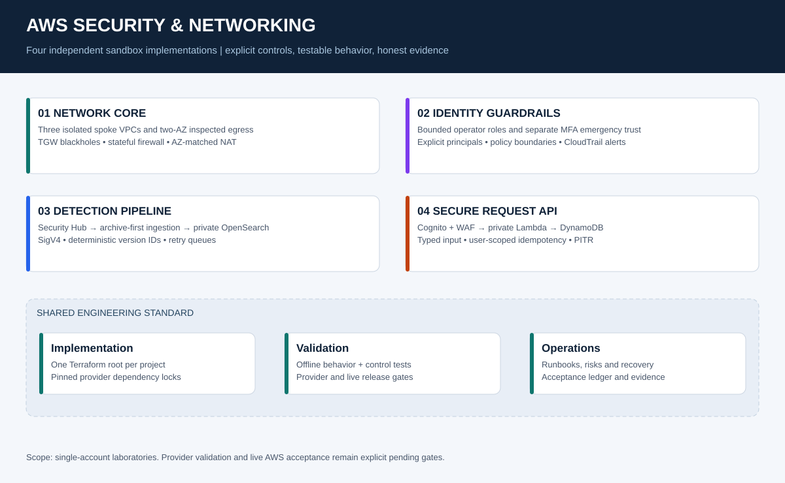

# 🛡️ AWS Security & Networking Portfolio

**Jamie Christian II · Network security · Identity controls · Detection engineering · Secure APIs**


Four complementary sandbox implementations demonstrate how to design, implement, test and operate AWS security controls. Each project has **one canonical Terraform root**, an architecture diagram, explicit threat assumptions, operational runbooks, a validation matrix and deployment instructions.

> **Verification status:** 186 offline tests passed, with 100% statement and branch coverage of both Lambda handlers, 8/8 targeted mutations detected and zero Bandit findings. Terraform provider initialization completed; provider-backed validation and mock plans are **not verified in this build environment** because provider IPC sockets were denied. No live AWS deployment or security test is claimed. Read the [validation report](reports/VALIDATION_REPORT.md) before using the code.

## 🚀 Start here

1. Read [START_HERE.md](START_HERE.md) for the fastest review or deployment path.
2. Read [deployment and state management](docs/DEPLOYMENT.md), including costs and account checks.
3. Run `python -m pip install -r requirements-dev.txt` and `make evidence` from this directory.
4. Run `make terraform-check` on a machine that can run Terraform provider plugins. It creates no AWS resources: tests use mock providers.
5. Review a real plan in a disposable AWS sandbox, then deploy one project at a time only when ready to accept its charges.

## 🧭 Project map

| Project | Implemented focus | Best review artifact |
|---|---|---|
| [01 · Network core](projects/01-network-core/README.md) | Three segmented VPCs, Transit Gateway, two-AZ Network Firewall and NAT egress, symmetric routes, flow logs | [Packet walkthrough](projects/01-network-core/docs/ARCHITECTURE.md) |
| [02 · IAM guardrails](projects/02-iam-guardrails/README.md) | Allow-and-deny boundaries, explicit role trust, MFA break-glass, audit logs, opt-in SCP | [Policy evaluation and trust](projects/02-iam-guardrails/docs/ARCHITECTURE.md) |
| [03 · Logging and detection](projects/03-security-logging-detection/README.md) | CloudTrail, GuardDuty, Security Hub, EventBridge, private OpenSearch, signed ingestion, archive, retry/DLQ | [Detection and recovery](projects/03-security-logging-detection/docs/RUNBOOK.md) |
| [04 · Secure API](projects/04-secure-serverless-api/README.md) | Cognito MFA, API Gateway, WAF, private Lambda, scoped DynamoDB access, PITR and idempotency | [API contract](projects/04-secure-serverless-api/docs/API_CONTRACT.md) |

## 🏗️ System view



These are independent, single-account sandbox stacks. They illustrate patterns that can be extended to an organization; they do **not** automatically create a landing zone, delegated security administrator or cross-account log archive. The network project uses multiple VPCs in one account, not multiple accounts. The IAM project's optional SCP requires organization permissions and a separately reviewed target.

## 🔐 Engineering decisions that matter

- **Network:** default TGW propagation is disabled. Explicit blackhole routes prevent cross-spoke traffic; internet egress goes through an AZ-matched firewall endpoint and NAT gateway. There is no inspection bypass fallback.
- **Identity:** boundaries contain an allow envelope and explicit denies. Routine roles cannot mutate IAM. Emergency access has separate trust, MFA and an hour-long session maximum.
- **Detection:** OpenSearch is reachable only inside its VPC. The ingestion role signs requests with SigV4 and can write only finding documents. Failed archive/index writes raise errors so retries and failure destinations work.
- **Application:** Cognito validates identity before Lambda. Requests are typed, size-limited and constrained to an action allowlist. Conditional DynamoDB writes prevent duplicate submissions, and idempotency keys are scoped to the authenticated subject.
- **Evidence:** a generated test plan is never treated as an executed AWS test. Local test results, pending checks and runtime evidence have different status labels.

## 🧪 What the checks prove

| Layer | Check | What it does not prove |
|---|---|---|
| Unit, property and SDK-emulation tests | Input validation, user-scoped idempotency, replay conflicts, normalization and failure propagation | Live AWS integration, token validation or delivery latency |
| Static control tests | Required routes, scoped policies, encryption flags, guardrails and connected handlers | Actual authorization, routing reachability or provider compatibility |
| Terraform validate / mock test | Provider schema compatibility and planned configuration assertions when run | An AWS deployment can succeed in a specific account |
| Live sandbox acceptance | Positive and negative behavior with collected evidence | Production scale, compliance certification or full penetration testing |

See the [test design and traceability](docs/TEST_STRATEGY.md) and machine-readable logs in `reports/`. Coverage measures exercised code, not complete security.

The [CI workflow](.github/workflows/validate.yml) runs offline checks and Terraform checks without AWS credentials. Its presence is not a claim that a GitHub Actions run has passed. [Evidence methodology](docs/EVIDENCE.md) explains the release gates.

## 📚 Technical review material

- [Deployment plan review](docs/PLAN_REVIEW.md) and [release readiness](docs/RELEASE_READINESS.md)
- [Control-to-test traceability](docs/CONTROL_TEST_TRACEABILITY.csv)
- [Control register](docs/CONTROL_REGISTER.csv) and [gap closure](docs/GAP_ANALYSIS.md)
- [Threat and risk register](docs/RISK_REGISTER.md)
- [Architecture decisions](docs/ARCHITECTURE_DECISIONS.md)
- [Costs and teardown](docs/COSTS_AND_CLEANUP.md)
- [Incident tabletop](docs/INCIDENT_TABLETOP.md)
- [Interview walkthrough](docs/INTERVIEW_GUIDE.md)
- [Source and migration notes](docs/MIGRATION.md)
- [Official references](docs/REFERENCES.md)

## 📁 Repository layout

```text
projects/<project>/iac/terraform/   Canonical Terraform JSON configuration and provider lock
projects/<project>/lambda/         Deployed Python handlers where applicable
projects/<project>/docs/           Architecture, deployment, threats, runbook and acceptance
projects/<project>/evidence/       Honest live-test ledger; initially NOT_RUN
scripts/                          Read-only evidence capture and opt-in live API checks
tests/                            Offline behavioral and structural security regressions
diagrams/                         Editable SVG architecture figures
reports/                          Build evidence and verification limitations
.github/workflows/                Credential-free CI
```

Terraform `.tf.json` is Terraform's supported JSON configuration syntax, not CloudFormation. The configuration is split by top-level block type for readability. The pinned provider versions are reproducibility choices, not claims that these are the latest releases; upgrades require a reviewed lockfile change and all checks.

## 👤 About this work

Built as a portfolio laboratory by **Jamie Christian II**. This work demonstrates implementation and engineering reasoning. It does not represent employment experience, client deployments, a production certification or an independently audited security rating.

[GitHub](https://github.com/JamieChristian22) · [LinkedIn](https://www.linkedin.com/in/jamiechristian2/)
