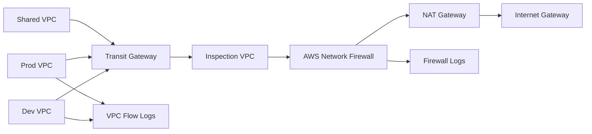

# 01 — Secure Multi-Account Network Core

A centralized AWS networking security design using **spoke VPCs, Transit Gateway, an Inspection VPC, AWS Network Firewall, controlled egress, VPC Flow Logs, and explicit route-table policy**.

## Business Scenario
A growing AWS environment requires separate production, development, and shared-services networks while enforcing centralized traffic inspection and consistent outbound controls.

## Architecture

## Security Requirements
- Production and development do not route directly to each other.
- Internet egress traverses the inspection path.
- Network Firewall logs are retained for investigation.
- VPC Flow Logs capture accept/reject metadata.
- Administrative traffic is not exposed through broad inbound rules.
- Route tables are treated as security controls.

## Validation
The evidence pack includes route-path tests, prohibited-path tests, inspection-log checks, and failure-mode scenarios. Live Reachability Analyzer screenshots are not fabricated; the included test plan defines exactly what should be proven after deployment.
