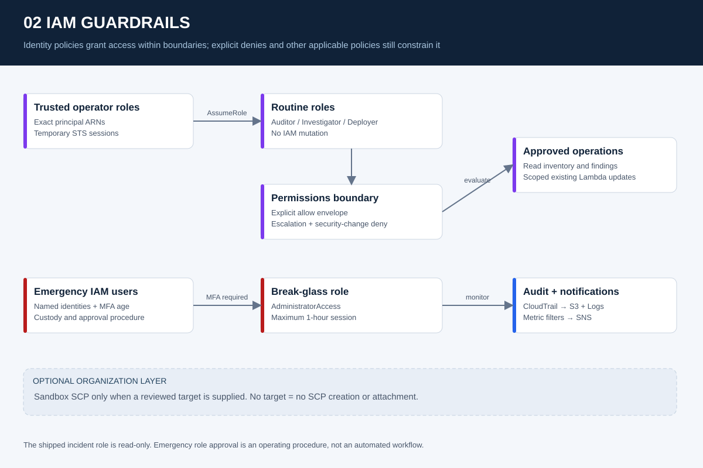

# IAM guardrails and emergency access

Routine operator roles have explicit trust and bounded permissions. Separate MFA-protected emergency access is monitored through CloudTrail. Organization guardrails are optional and remain disabled unless a sandbox target is supplied.

## Review and run

- [Architecture and boundaries](docs/ARCHITECTURE.md)
- [Deployment prerequisites and commands](docs/DEPLOYMENT.md)
- [Threat model](docs/THREAT_MODEL.md)
- [Operational runbook](docs/RUNBOOK.md)
- [Acceptance procedure](docs/VALIDATION.md)
- [Live evidence ledger](evidence/ACCEPTANCE.csv)
- [Canonical Terraform root](iac/terraform/)

Start with the repository [deployment guide](../../docs/DEPLOYMENT.md). This project has no claimed live AWS validation in the delivered package. See the [release report](../../reports/VALIDATION_REPORT.md) for executed checks and limitations.

## Definition of done

Provider validation and mock plans pass; an account-specific plan is reviewed; an authorized sandbox deployment succeeds; the listed positive and negative controls have actual evidence; alert delivery and cleanup are verified. A diagram or simulated expected result does not satisfy these gates.
