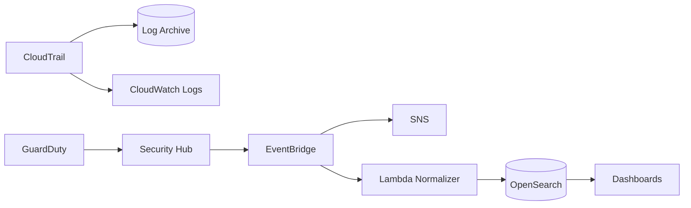

# 03 — Centralized Security Logging & Detection

A centralized detection-engineering architecture using **CloudTrail, GuardDuty, Security Hub, EventBridge, Lambda, OpenSearch, SNS, CloudWatch, and protected S3 log storage**.

## Detection Flow

## Goals
- central API audit visibility
- high/critical finding alerts
- searchable normalized findings
- evidence retention
- repeatable incident triage
- measurable detection coverage
