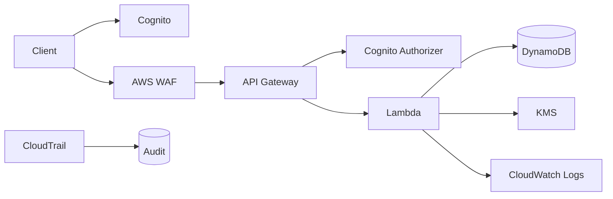

# 04 — Secure Serverless API

A secure application architecture using **API Gateway, Cognito, AWS WAF, Lambda, DynamoDB, KMS, VPC endpoints, CloudWatch, CloudTrail, and least-privilege IAM**.

## Architecture

## Security Objectives
- authenticated requests only for protected routes
- throttling/rate controls at the edge
- least-privilege Lambda role
- encrypted DynamoDB and logs
- no secrets in source code
- input validation
- actionable alarms
- incident/recovery procedures
